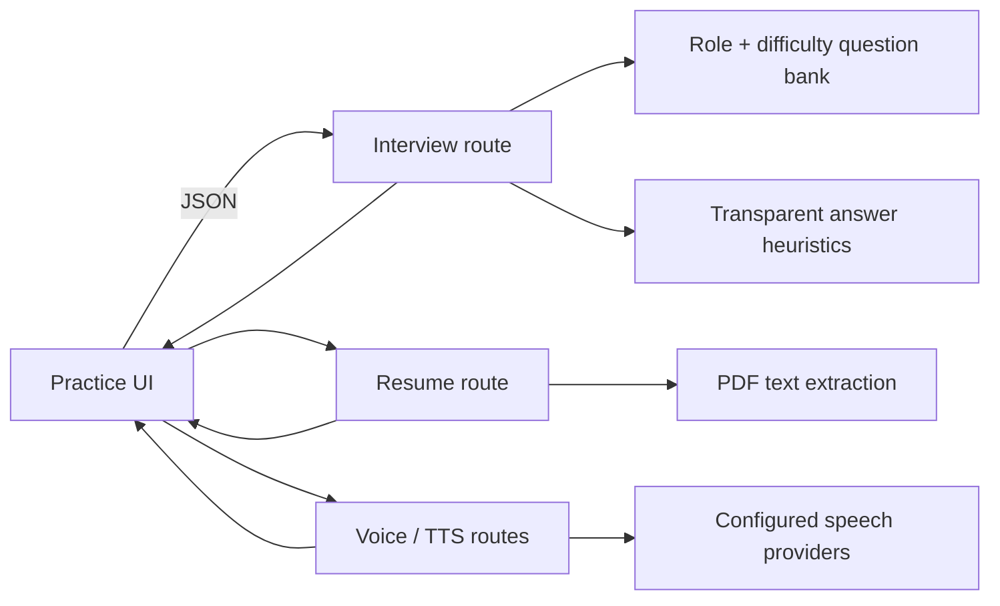

# Avanti InterviewCoach

An interview-practice prototype that combines role-specific behavioral questions, resume ingestion, voice routes, and structured answer feedback in a responsive Next.js application.

> This repository began with Create Next App. The interview flows, API routes, visual design, question bank, answer analysis, resume parsing, and voice integrations are project work; Next.js, React, and the packages in `package.json` are third-party dependencies.

## Problem and implemented scope

Interview practice is most useful when it is specific and repeatable. Avanti lets a learner choose a role and difficulty, practice a question, and receive feedback emphasizing ownership, STAR structure, detail, and measurable outcomes. Separate routes handle PDF resume parsing, text-to-speech, voice input, and session summaries.

The answer scorer in `src/app/api/interview/route.ts` is deliberately a transparent heuristic—not a claim of validated AI assessment. It uses answer length and explicit signals such as STAR terms, ownership language, causal explanation, and numbers. Other routes integrate Groq, OpenAI, and ElevenLabs when their environment variables are configured.

## Architecture and data flow



- App Router pages own onboarding, practice, pricing, signup, and voice interfaces.
- Route handlers keep provider credentials server-side and return JSON to the browser.
- Question selection avoids immediately repeating the previous question.
- Resume and speech capabilities have separate endpoints so they can fail independently.

## Technical decisions

- **Explainable baseline feedback:** the practice route exposes what influences feedback instead of presenting a black-box score as objective truth.
- **Provider boundaries:** resume, LLM, and speech work live in route handlers rather than client components.
- **Prototype-first scope:** there is no database-backed user history or validated hiring prediction in this repository.

## Run locally

```bash
npm install
npm run dev
```

Copy only the provider variables required by the route you are testing into `.env.local`. Never commit that file. Inspect the files under `src/app/api/` for current variable names.

```bash
npm run build
npm run lint
```

## Limitations

- Feedback is coaching guidance, not a hiring recommendation or psychometric evaluation.
- The heuristic score is not trained, calibrated, or benchmarked.
- Provider-backed routes require external credentials and inherit provider availability and cost limits.
- Resume processing needs an explicit retention/privacy policy before production use.
- Automated tests are not yet present.
